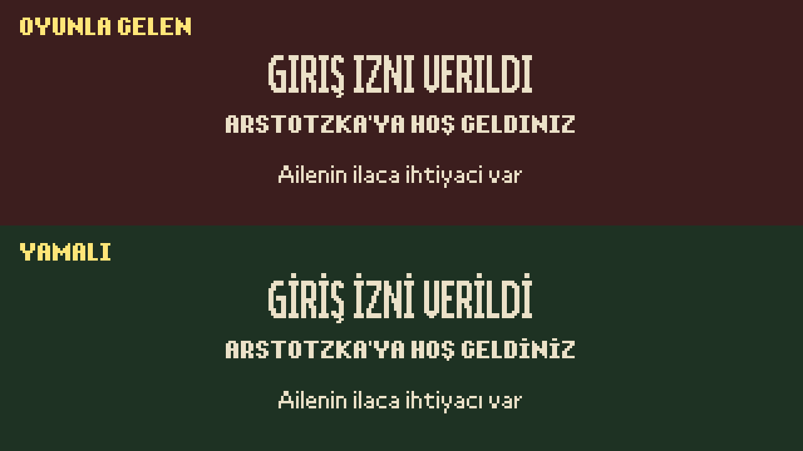
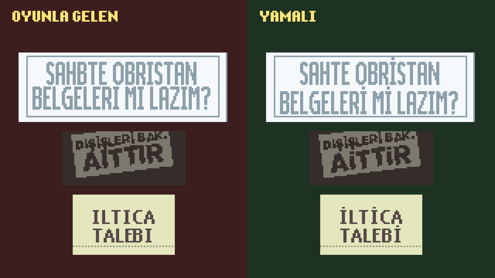

# Papers, Please TR: oyunla gelen Türkçe çevirinin düzeltmesi

Papers, Please'in Türkçe dil paketi oyunla birlikte gelir, ama yazı tiplerinde **İ** ve **ı** harfleri eksiktir: oyunda bu harfler ya boş görünür ya da noktalı i olarak çıkar. Çeviride de bu yüzden birçok kelime I ve i ile yazılmıştır ("BITIŞ TARIHI"). Bu yama oyunla gelen Türkçe çeviriyi düzeltir:

- Oyunun 10 yazı tipine **İ** ve **ı** harfleri, her yazı tipinin kendi piksel tarzında eklenir.
- Metinde 251 kelimenin yazımı 473 yerde düzeltilir: "BITIŞ TARIHI" → "BİTİŞ TARİHİ", "GEÇERLILIK" → "GEÇERLİLİK".
- Belgelerin ve kural kitabının içine resim olarak çizilmiş yazılarda 49 görselde 108 kelime, oyunun yazı tipiyle yeniden çizilir.
- Ayrıca birkaç yazım hatası ("SAHBTE" → "SAHTE", "Artotzka" → "Arstotzka"), silah sayfasındaki iki yanlış talimat ve belgelerde birbirine değen birkaç yazı.

Çeviri baştan yapılmadı; metnin geri kalanı oyunla geldiği gibidir.

<p align="center">
  
  
</p>

Hazırlayan: **Vechiron**

### ⬇ [Kurulum dosyasını indir (PapersPleaseTR-Kurulum.exe)](https://github.com/vechiron/PapersPlease-TR/releases/latest/download/PapersPleaseTR-Kurulum.exe)

Tüm sürümler: [Releases](https://github.com/vechiron/PapersPlease-TR/releases)

## Gereksinimler

- Papers, Please, Windows (test edilen sürüm: 1.4.11.124, Steam)

Başka bir şey gerekmez. Kurulum programı oyunun Türkçe paketini tanımazsa (başka bir sürüm ya da başka bir yamayla değiştirilmiş paket) hiçbir dosyaya dokunmaz.

## Kurulum (3 adım)

1. **[PapersPleaseTR-Kurulum.exe](https://github.com/vechiron/PapersPlease-TR/releases/latest/download/PapersPleaseTR-Kurulum.exe)** dosyasını indirin.
2. Çalıştırın. Windows "Bilinmeyen yayımcı" (SmartScreen) uyarısı verirse **Ek bilgi > Yine de çalıştır** deyin; program dijital olarak imzalı olmadığı için bu uyarı normaldir.
3. Açılan pencerede **1** yazıp Enter'a basın. Oyun klasörü Steam'in kayıtlarından otomatik bulunur; bulunamazsa program klasörün yolunu sorar (Steam'de oyuna sağ tıklayın > **Yönet > Yerel dosyalara göz at**, açılan pencerenin adres çubuğundaki yol). Oyunu açın, hepsi bu.

**Kaldırmak için** programı yeniden çalıştırın: yama kuruluysa **1** yamayı kaldırır ve oyunla gelen Türkçe paketi geri koyar.

**Yazılar Türkçe görünmüyorsa:** oyunun dil seçeneğinden Türkçe'yi seçin.

**Oyun güncellenirse:** Steam'in güncellemesi ya da "Oyun dosyalarının bütünlüğünü doğrula" işlemi oyunla gelen paketi geri getirip yamayı kaldırabilir. O zaman programı yeniden çalıştırın. Güncelleme Türkçe paketin kendisini değiştirdiyse program paketi tanımaz ve dokunmaz; yamanın yeni sürümü gerekir.

## Antivirüs uyarısı

Bazı antivirüsler kurulum programını "şüpheli" olarak işaretleyebilir. Bu bir yanlış alarmdır. Programın yapısı antivirüslerin gözünde zararlı yazılımlara benzer:

- İçinde başka bir program taşır: `PapersPleaseTR-Kurulum.exe`, resmî Node.js v24.18.0 programının bir kopyasıdır; içine kurulum betiği eklenmiş, simgesi ve dosya bilgisi değiştirilmiştir. Dosyanın 92 MB olmasının nedeni budur.
- Bir oyunun dosyasını değiştirir.
- Dijital olarak imzalı değildir.

Kurulum programının bütün kaynak kodu bu depodadır; kendiniz derleyebilirsiniz (aşağıda: **Derleme**).

İndirdiğiniz dosyanın buradaki sürüm olduğunu karmasıyla doğrulayabilirsiniz: dosyanın bulunduğu klasörde PowerShell'e `Get-FileHash .\PapersPleaseTR-Kurulum.exe` yazın. Çıkan değer aşağıdakiyle aynı olmalıdır (büyük/küçük harf fark etmez).

| dosya (v1.0.0) | SHA-256 |
|---|---|
| `PapersPleaseTR-Kurulum.exe` | `c35bb1890217cec36ef327b274a609dad6c4334b7a5ce2d37eafe261a96dbc36` |
| `Node.js-LICENSE.txt` | `148eacf7863ef4329224a29398623077200a27194aa075569faf4a0a85566ca5` |

Güncel VirusTotal sonucu: [PapersPleaseTR-Kurulum.exe](https://www.virustotal.com/gui/file/c35bb1890217cec36ef327b274a609dad6c4334b7a5ce2d37eafe261a96dbc36)

## Nasıl çalışır?

- Program oyunun hiçbir dosyasını içinde taşımaz. Yamalı Türkçe paketi o an sizin bilgisayarınızdaki paketten (`PapersPlease_Data\StreamingAssets\loc\tr.zip`) üretir.
- Önce paketin oyunla geldiği hâli olduğunu karmasıyla denetler. Üretilen paket yamanın beklenen sonucuyla birebir aynı değilse hiçbir şey yazmaz.
- Oyunla gelen paketin yedeğini `%LOCALAPPDATA%\PapersPleaseTR\tr.zip` olarak alır; kaldırırken buradan geri koyar. Ne yaptığını aynı klasördeki `kurulum.log` dosyasına yazar.
- Yeni paketi önce geçici bir dosyaya yazıp geri okuyarak denetler, sonra eskisinin yerine tek adımda geçirir. Oyun açıksa kapanmasını bekler.
- Oyun klasöründe Türkçe paketten başka hiçbir dosyayı değiştirmez.

Komut satırından oyun klasörü verilebilir: `PapersPleaseTR-Kurulum.exe --oyun "D:\Oyunlar\Papers Please"`.

## Depo düzeni

| dosya | ne |
|---|---|
| `araclar/kurucu.mjs` | kurulum programı: oyunu bulur, yamayı kurar ya da kaldırır |
| `araclar/yama.mjs` | yamanın kendisi: oyunla gelen paketten yamalı paketi üretir (yazı tipi, metin, görsel) |
| `araclar/duzeltmeler.tsv` | metin düzeltmeleri (yanlış → doğru) |
| `araclar/gorsel-yerler.tsv` | görsellerde düzeltilecek kelimelerin yeri |
| `araclar/gorsel.mjs` | görsellerdeki yazıyı bulma ve yeniden çizme |
| `araclar/metin.mjs` | `Loc.csv` ve `Text.xml` düzeltmesi |
| `araclar/png.mjs`, `araclar/zip.mjs` | PNG ve zip okuma, yazma |
| `araclar/simge.mjs` | programın simgesi |
| `araclar/kurucu-derle.mjs` | programı exe'ye derler ve sahte bir oyun klasöründe sınar |

Kodun yorumlarında adı geçen `gorsel-ara.mjs`, `gorsel-teshis.mjs`, `harita.mjs`, `tr-yama.mjs`, `yayin.mjs` geliştirme sırasında oyunun klasöründe kullanılan araçlardır; oyunun dosyalarını okuyup yazdıkları için bu depoda yoktur.

## Derleme

Gerekenler: Windows, [Node.js](https://nodejs.org/) v24 (v1.0.0 v24.18.0 ile derlendi), internet bağlantısı (esbuild, postject ve resedit-cli `npx` ile indirilir; Node.js'in lisansı GitHub'dan).

1. Oyunla gelen Türkçe paketi (`PapersPlease_Data\StreamingAssets\loc\tr.zip`) depoda `yedek\tr.zip` olarak kopyalayın. Yama kuruluysa paket değişmiştir; o zaman yedeği kullanın: `%LOCALAPPDATA%\PapersPleaseTR\tr.zip`.
2. Derleyin:

   ```bat
   node araclar/kurucu-derle.mjs
   ```

Çıktı: `derleme\PapersPleaseTR-Kurulum.exe` ve `derleme\Node.js-LICENSE.txt`. Betik exe'yi sahte bir oyun klasöründe sınar (kur, kaldır, tanınmayan paket); sonunda "Derleme ve sınama tamam." yazmalıdır. Node.js v24.18.0 ile derlenen exe, **Antivirüs uyarısı** bölümündeki SHA-256 ile aynı çıkmalıdır; böylece indirdiğiniz exe'nin bu kaynak koddan derlendiğini kendiniz doğrulayabilirsiniz. Exe'ye çevirmeden denemek için: `node araclar/kurucu.mjs --oyun "<oyun klasörü>"`.

## Yeni sürüm yayınlama (geliştiriciler için)

1. Sürüm numarasını `araclar/kurucu.mjs`'te (`SURUM`) güncelleyin; exe'nin dosya bilgisi buradan okunur.
2. Derleyin.
3. **Antivirüs uyarısı** bölümündeki sürümü, karmaları ve VirusTotal bağlantısını yeni dosyalara göre güncelleyin. Bağlantının sonuç göstermesi için exe'yi VirusTotal'a bir kez yükleyin.
4. Değişiklikleri gönderip sürümü [GitHub CLI](https://cli.github.com/) ile yayınlayın:

   ```bat
   gh release create vX.Y.Z derleme\PapersPleaseTR-Kurulum.exe derleme\Node.js-LICENSE.txt --title "Papers, Please TR vX.Y.Z" --notes "Değişiklikler..."
   ```

   Dosya adlarını değiştirmeyin; README'deki "en son sürümü indir" bağlantıları bu adlara göre çalışır.

## Lisans

- Kod ve tablolar (`araclar/`): MIT lisanslı, © 2026 Vechiron (bkz. `LICENSE`).
- Papers, Please, Lucas Pope'un eseridir; oyunla gelen Türkçe çeviri oyunun parçasıdır. Bu depo ve kurulum programı oyunun hiçbir dosyasını içermez; tablolarda yalnızca düzeltilen kelimeler ve yerleri vardır.
- Kurulum programı Node.js'i (MIT) içerir; lisansı `Node.js-LICENSE.txt`, sürüm sayfasında exe ile birlikte.
